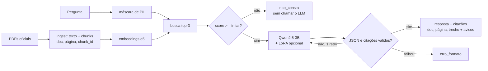

# Relatório — LLM local para a Defesa Civil (protocolos de incêndio)
GS 2026.2 · CitizenTech · Generative AI for Engineering

## 1. Integrantes
| Nome completo | RM |
|---|---|
| _(preencher)_ | _(preencher)_ |

## 2. Ficha técnica
| Item | Valor |
|---|---|
| Tarefa | Responder perguntas sobre protocolos de incêndio com base apenas em 9 PDFs, em JSON com citação, ou recusar |
| Modelo | Qwen/Qwen2.5-3B-Instruct (local, fp16; QLoRA 4-bit no treino) |
| Embeddings | intfloat/multilingual-e5-base (cosseno, vetores normalizados) |
| Chunking | ~1000 caracteres, sobreposição 150, mínimo 200; guarda doc, páginas e chunk_id |
| Busca | top-3 + limiar de similaridade (`results/threshold.json`) |
| Especialização | LoRA: r=16, α=32, dropout 0,05, atenção+MLP, 2 épocas, lr 2e-4, batch efetivo 8, dados sintéticos (ok / negativos difíceis / fora do escopo), sem vazamento do gabarito |
| Decodificação | gulosa, até 400 tokens, semente 42 |
| Ambiente | Google Colab (GPU) acessado pelo VSCode |
| Avaliação | 40 perguntas (28 respondíveis + 12 "não consta"); 20 dev (calibra limiar) / 20 teste (resultado) |

## 3. Diagrama do pipeline

## 4. Base de conhecimento
Tabela completa e atualizada em `base/fontes.csv` (gerada no notebook 01). Resumo:

| ID | Documento | Instituição | Formato | Licença/uso | Páginas | Trechos |
|---|---|---|---|---|---|---|
| DOC001 | Roteiro Metodológico (planos operativos) | IBAMA/Prevfogo | PDF | não declarada; uso acadêmico com fonte | 46 | _(do notebook 01)_ |
| DOC002 | Guia Prático de Manejo Integrado do Fogo | ISPN/IBAMA | PDF | não declarada; uso acadêmico com fonte | 37 | _" "_ |
| DOC003 | Cartilha PNMIF | IBAMA | PDF | não declarada; uso acadêmico com fonte | 36 | _" "_ |
| DOC004 | É possível controlar o fogo | ISPN | PDF | não declarada; status histórico | 4 | _" "_ |
| DOC005 | Apostila do Brigadista | ICMBio/MMA | PDF | não declarada; uso acadêmico com fonte | 90 | _" "_ |
| DOC006 | SCI-100 | IBAMA/ICMBio/USFS | PDF | reprodução sem alteração, com fonte, sem fins comerciais | 85 | _" "_ |
| DOC007 | SCI-200 | IBAMA/USFS | PDF | idem | _(nb 01)_ | _" "_ |
| DOC008 | SCI-300 | IBAMA/ICMBio/USFS | PDF | idem | _(nb 01)_ | _" "_ |
| DOC009 | Instrução Técnica 16 (CBPMESP) | Bombeiros SP | PDF | não declarada; **verificar vigência** (cabeçalho "16/2011") | 13 | _" "_ |

## 5. Desempenho das configurações
Preencher a partir de `avaliacao/RESULTADOS.md` (gerado do que o notebook 05 salvou) — resultado principal é o split **teste**.

| Config | Acurácia | Alucinação | Recusa correta | Recusa indevida | JSON válido | Citação correta |
|---|---|---|---|---|---|---|
| A — base sem contexto | | | | | | |
| B — RAG simples | | | | | | |
| C — RAG + LoRA | | | | | | |

Busca: recall@1 = __ · recall@3 = __ · limiar = __ (calibrado no dev; confirmado no teste: precisão __, recall __).

**Interpretação** _(4–6 linhas após rodar)_: B vs A (acerto e alucinação), o que o LoRA muda em C, onde nenhuma configuração acerta, e se as diferenças superam o IC95% do bootstrap (n=20 → IC largo).

## 6. Cinco erros reais, causa e correção
Gerados em `avaliacao/erros.json` pelo notebook 05 e conferidos manualmente (`recuperados`, `raw`, trecho citado).

| # | Config | Pergunta | Resposta do sistema | Causa confirmada | Correção |
|---|---|---|---|---|---|
| 1–5 | _(do notebook 05)_ | | | | |

## 7. Conclusão técnica
_(Escrever após os resultados: o que melhorou frente ao modelo sem contexto, o custo do LoRA, limitações — gabarito de 40 perguntas, dados sintéticos de treino, PDFs com vigência a verificar — e próximos passos.)_

- Repositório: _(URL pública do GitHub)_
- Vídeo: _(URL)_
